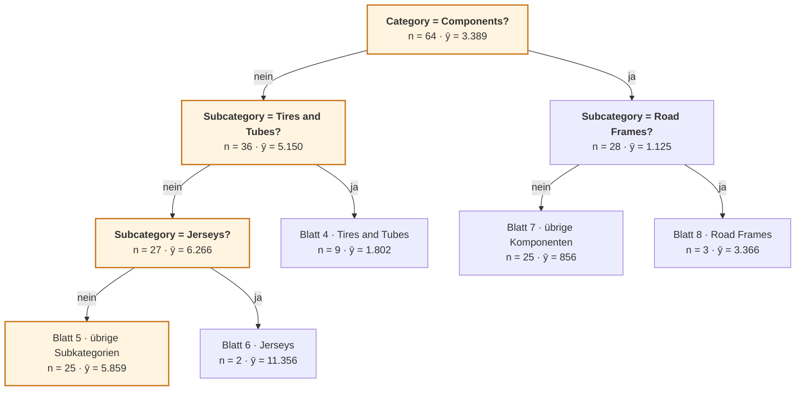

# Projekt 14 – Vorhersage numerischer Werte mit einem Regressionsbaum

Verkaufsprognose mit einem **linearen Regressionsbaum (Modellbaum)** auf Basis von Produkteigenschaften aus dem Data Warehouse **AdventureWorksDW**.
Hausarbeit im Modul *Business Intelligence and Corporate Performance Management* (MSc Wirtschaftsinformatik, Hochschule Reutlingen).

---

## Inhalt

- [Aufgabenstellung](#aufgabenstellung)
- [Ergebnisse auf einen Blick](#ergebnisse-auf-einen-blick)
- [Vorgehen](#vorgehen)
- [Das Modell: `LinearRegressionTree`](#das-modell-linearregressiontree)
- [Merkmalswahl und Pruning](#merkmalswahl-und-pruning)
- [Installation und Ausführung](#installation-und-ausführung)
- [Datenbasis](#datenbasis)
- [Einschränkungen](#einschränkungen)
- [Ausblick](#ausblick)

---

## Aufgabenstellung

> Erstellen Sie einen Regressionsbaum zur Verkaufsprognose. Der Baum sollte bezüglich der Hierarchiestufen minimiert werden und die Vorhersagefunktion sollte linear sein.

Die Lösung beantwortet zwei Fragen:

1. **Welche Subkategorien erzielen die größten Stückzahlen?**
2. **Wie wird sich ein neues Produkt „Road-Racer“ verkaufen?**
   Produktlinie = *Road*, Modell = *Road-150*, Kategorie = *Bikes*, Subkategorie = *Road Bikes*

Zusätzlich verlangt die Anleitung, die Wahl der optimalen Aufteilungsmerkmale (Produkteigenschaften), das Pruning und die Ermittlung der Vorhersagemodelle am Beispiel zu zeigen.

---

## Ergebnisse auf einen Blick

| Frage                              | Ergebnis                                                                                            |
| ---------------------------------- | --------------------------------------------------------------------------------------------------- |
| Absatzstärkste Subkategorien      | **Road Bikes** (47.148 Stück), **Mountain Bikes** (28.321), **Jerseys** (22.711) |
| Prognose Road-Racer                | **≈ 2.652 Stück** im Datenzeitraum (Blatt 5, Analogieschätzung zum Modell Road-150)        |
| Ausgewählter Baum                 | 3 Hierarchiestufen, 5 Blätter, Aufteilungen nur über Kategorie und Subkategorie                   |
| Prognosegüte (Validierung / Test) | RMSE 1.283,55 / 2.551,33 · MAE 924,64 / 1.879,13 · R² −0,58 / −0,40                            |

<details>
<summary><b>Top 5 der Subkategorien nach Stückzahl</b></summary>

| Rang | Subkategorie    | Stückzahl | Anteil kumuliert |
| ---: | --------------- | ---------: | ---------------: |
|    1 | Road Bikes      |     47.148 |           17,2 % |
|    2 | Mountain Bikes  |     28.321 |           27,5 % |
|    3 | Jerseys         |     22.711 |           35,7 % |
|    4 | Helmets         |     19.541 |           42,8 % |
|    5 | Tires and Tubes |     18.006 |           49,4 % |

Gesamt: 274.776 Stück aus 121.253 Bestellpositionen (Internet- und Reseller-Kanal, 29.12.2010 – 28.01.2014).

</details>

> [!IMPORTANT]
> Das negative R² bedeutet, dass das Modell auf neuen Daten schlechter prognostiziert als der Mittelwert. Die Ursache ist im Abschnitt [Einschränkungen](#einschränkungen) erklärt. Die Prognose für den Road-Racer gibt den bisherigen Absatz des Modells Road-150 wieder und ist als Orientierungswert zu lesen, nicht als belastbare Punktprognose.

---

## Vorgehen

```mermaid
flowchart LR
    A[(AdventureWorksDW<br/>SQL Server)] -->|SQL-Abfrage<br/>Internet + Reseller| B[Bestellpositionen<br/>121.253 Zeilen]
    B -->|Aggregation je<br/>Kategorie · Subkategorie ·<br/>Produktlinie · Modell| C[92 Merkmals-<br/>kombinationen]
    C -->|Split 70/15/15<br/>random_state=42| D[Train 64 · Val 14 · Test 14]
    D -->|One-Hot-Encoding<br/>nur auf Train angepasst| E[97 binäre Merkmale]
    E -->|Gittersuche<br/>2.160 Kombinationen| F[LinearRegressionTree]
    F --> G[Prognose Road-Racer<br/>+ Auswertung]
```



1. **Extraktion:** Die Faktentabellen `FactInternetSales` und `FactResellerSales` werden mit der Produktdimension (`DimProduct` → `DimProductSubcategory` → `DimProductCategory`) verknüpft und per `UNION ALL` zusammengeführt.
2. **Aggregation:** Die Zielgröße ist die Summe von `OrderQuantity` je Kombination aus Kategorie, Subkategorie, Produktlinie und Modell.
3. **Aufteilung:** Trainings-, Validierungs- und Testmenge im Verhältnis 70 : 15 : 15. Die Validierungsmenge dient der Hyperparameterwahl, die Testmenge nur der abschließenden Bewertung.
4. **Kodierung:** `OneHotEncoder(handle_unknown="ignore")` wird ausschließlich auf der Trainingsmenge angepasst, damit keine Information aus Validierung oder Test einfließt.
5. **Modellierung:** Gittersuche über sechs Pruning-Parameter; Auswahl nach minimalem Validierungs-RMSE.
6. **Anwendung:** Prognose für den Road-Racer sowie deskriptive Auswertung der Subkategorien.

---

## Das Modell: `LinearRegressionTree`

Ein klassischer Regressionsbaum sagt in jedem Blatt einen **konstanten Mittelwert** voraus. Die Aufgabe verlangt eine **lineare Vorhersagefunktion**. Deshalb kombiniert `LinearRegressionTree` zwei Stufen:

| Stufe | Baustein                      | Aufgabe                                                                             |
| ----- | ----------------------------- | ----------------------------------------------------------------------------------- |
| 1     | `DecisionTreeRegressor`     | lernt die Baumstruktur mit dem SSE-Kriterium (Varianzreduktion)                     |
| 2     | `LinearRegression` je Blatt | schätzt pro Blatt ein eigenes lineares Modell auf den Beobachtungen dieses Blattes |

Die Vorhersage ordnet eine Beobachtung über `apply()` ihrem Blatt *ℓ* zu und wertet dessen lineares Modell aus:

$$
\hat{y}(\mathbf{x}) = \beta_{0,\ell(\mathbf{x})} + \sum_{j=1}^{p} \beta_{j,\ell(\mathbf{x})}\, x_j
$$

```python
model = LinearRegressionTree(
    max_depth=3,
    max_leaf_nodes=5,
    min_samples_leaf=2,
    min_samples_split=2,
    min_impurity_decrease=0.0,
    ccp_alpha=0.0,
)
model.fit(X_train, y_train)

model.get_tree_info()        # Knoten, Blätter, Tiefe
model.get_leaf_models()      # Achsenabschnitt und Koeffizienten je Blatt
model.get_pruning_path(X_train, y_train)   # Kostenkomplexitätspfad (ccp_alpha)
y_pred = model.predict(X_test)
```

### Ausgewählter Baum



Der Road-Racer (Bikes, Road Bikes) folgt dem hervorgehobenen Pfad und landet in **Blatt 5**. ȳ ist der mittlere Absatz je Modell im Knoten.

---

## Merkmalswahl und Pruning

### Welche Produkteigenschaft wird gewählt?

An jedem Knoten wird das Merkmal gewählt, das die Summe der quadrierten Abweichungen (SSE) am stärksten senkt. Die Werte sind aus den Knotenstatistiken des trainierten Baums berechnet:

| Knoten                    | gewähltes Merkmal              |  n | SSE-Reduktion | Anteil an Gesamtstreuung |
| ------------------------- | ------------------------------- | -: | ------------: | -----------------------: |
| Wurzel                    | `Category_Components`         | 64 |    255,1 Mio. |                   22,9 % |
| Nicht-Komponenten         | `Subcategory_Tires and Tubes` | 36 |    134,5 Mio. |                   12,1 % |
| übrige Nicht-Komponenten | `Subcategory_Jerseys`         | 27 |     55,9 Mio. |                    5,0 % |
| Komponenten               | `Subcategory_Road Frames`     | 28 |     16,9 Mio. |                    1,5 % |

Zusammen erklären die vier Aufteilungen **41,6 %** der Trainingsstreuung. Produktlinie und Modell kommen in der Struktur nicht vor: Jeder Modell-Indikator gilt nur für eine Beobachtung, eine Aufteilung danach verbietet `min_samples_leaf=2`.

### Pre-Pruning (Gittersuche)

| Parameter                 | untersuchte Werte | gewählt    |
| ------------------------- | ----------------- | ----------- |
| `max_depth`             | 2, 3, 4, 5        | **3** |
| `min_samples_split`     | 2, 5, 10          | 2           |
| `min_samples_leaf`      | 2, 5, 10          | 2           |
| `max_leaf_nodes`        | 3, 5, 10          | **5** |
| `min_impurity_decrease` | 0 … 0,1          | 0           |
| `ccp_alpha`             | 0 … 0,1          | 0           |

|       Tiefe |    Blätter |  Validierungs-RMSE |
| ----------: | ----------: | -----------------: |
|           2 |           4 |           1.290,36 |
| **3** | **5** | **1.283,55** |
|           4 |           8 |           1.880,25 |
|           5 |          10 |           2.059,16 |

Ab Tiefe 4 steigt der Fehler deutlich, zusätzliche Hierarchiestufen führen also zu Überanpassung. Tiefe 2 liegt nur 0,5 % über dem Minimum.

### Post-Pruning (Kostenkomplexitätspfad)

Weakest-Link-Pruning nach CART auf dem ausgewählten Baum:

| Schritt | zurückgeschnittene Aufteilung | effektives α | Blätter | Tiefe |
| ------: | ------------------------------ | ------------: | -------: | ----: |
|       0 | –                             |             0 |        5 |     3 |
|       1 | Road Frames                    |       263.679 |        4 |     3 |
|       2 | Jerseys                        |       874.163 |        3 |     2 |
|       3 | Tires and Tubes                |     2.101.881 |        2 |     1 |
|       4 | Components (nur Wurzel)        |     3.986.652 |        1 |     0 |

> [!NOTE]
> `ccp_alpha` und `min_impurity_decrease` haben die Einheit einer quadrierten Abweichung (hier Stück²). Bei einer Wurzel-Unreinheit von ca. 1,7 · 10⁷ blieben die Gitterwerte bis 0,1 wirkungslos. Sinnvolle Werte liefert `get_pruning_path()` bzw. `cost_complexity_pruning_path()`.

---

## Installation und Ausführung

**Voraussetzungen:** Python 3.10 oder neuer und Zugriff auf eine SQL-Server-Instanz mit der Beispieldatenbank [AdventureWorksDW](https://github.com/microsoft/sql-server-samples/tree/master/samples/databases/adventure-works).

<!-- TODO: Falls vorhanden, durch `pip install -r requirements.txt` bzw. `pip install -e .` ersetzen und den SQL-Server-Treiber (z. B. pyodbc) ergänzen. -->

**Ablauf:**

1. SQL-Abfrage gegen AdventureWorksDW ausführen und das Ergebnis als Parquet unter dem Pfad `QUERY_DATA_FILE` speichern. Alle Pfade sind in `vnw/defines/defines.py` definiert.
2. `LoadPrepareData` lädt die Parquet-Datei und bereitet die Datumsfelder auf.
3. `TrainTestValSplitter` erzeugt Trainings-, Validierungs- und Testmenge und speichert sie als Parquet.
4. `FeatureEngineer` kodiert die Produktmerkmale per One-Hot-Encoding.
5. `LinearRegressionTree` wird per Gittersuche trainiert, ausgewählt und auf den Road-Racer angewendet.

<!-- TODO: Notebook-Namen und Reihenfolge eintragen, z. B. „01_datenaufbereitung.ipynb → 02_modell.ipynb“. -->

### Zentrale Bausteine

| Klasse                   | Aufgabe                                                                                             |
| ------------------------ | --------------------------------------------------------------------------------------------------- |
| `LoadPrepareData`      | lädt die Bestellpositionen aus Parquet, bereinigt `ProductLine`, leitet Jahr, Monat und Woche ab |
| `TrainTestValSplitter` | 70/15/15-Aufteilung mit festem `random_state=42`, Export als Parquet                              |
| `FeatureEngineer`      | One-Hot-Encoding der kategorialen Merkmale, nur auf Trainingsdaten angepasst                        |
| `LinearRegressionTree` | Modellbaum: Baumstruktur per `DecisionTreeRegressor`, lineares Modell je Blatt                    |

---

## Datenbasis

| Eigenschaft                          | Wert                                                              |
| ------------------------------------ | ----------------------------------------------------------------- |
| Quelle                               | AdventureWorksDW (Microsoft SQL Server)                           |
| Faktentabellen                       | `FactInternetSales`, `FactResellerSales`                      |
| Dimensionen                          | `DimProduct`, `DimProductSubcategory`, `DimProductCategory` |
| Zeitraum                             | 29.12.2010 – 28.01.2014                                          |
| Bestellpositionen                    | 121.253                                                           |
| Kategorien / Subkategorien / Modelle | 4 / 35 / 107                                                      |
| Merkmale                             | Kategorie, Subkategorie, Produktlinie, Modell (kategorial)        |
| Zielgröße                          | Summe `OrderQuantity` je Merkmalskombination                    |

---

## Einschränkungen

- **Die Blattmodelle interpolieren.** Jedes Blattmodell wird über alle 97 Merkmale geschätzt, obwohl ein Blatt nur 2 bis 25 Beobachtungen enthält. Da jede Zeile einen eigenen Modell-Indikator hat, gibt das lineare Modell seine Trainingswerte exakt wieder (Trainingsfehler ≈ 0). Zum Vergleich: Derselbe Baum mit konstanten Blättern hat einen Trainings-RMSE von 3.185.
- **Die Road-Racer-Prognose ist ein Lookup.** Der dominante Beitrag kommt von `Model_Road-150`, daher entspricht die Prognose dem bisherigen Absatz von Road-150. Sie hängt vom Zufallssplit ab: Läge Road-150 in Validierung oder Test, sähe die Prognose anders aus. Ein Baum mit konstanten Blättern würde 5.859 Stück vorhersagen (Mittelwert von Blatt 5).
- **Kleine Datenbasis.** 92 Zeilen und je 14 Beobachtungen in Validierung und Test führen zu instabilen Fehlerschätzungen.
- **Zielgröße ohne Zeitbezug.** Der Gesamtabsatz über gut drei Jahre benachteiligt später eingeführte Modelle.
- **Offene Prüfung:** Die Rohdaten enthalten 107 Modelle, der aggregierte Datensatz nur 92 Zeilen. Mögliche Ursache: `groupby` verwirft fehlende `ProductLine`-Werte (`dropna=True`).

---

## Ausblick

- **Analyseeinheit Produkt statt Modell.** Dann beschreibt „Modell“ eine Gruppe mehrerer Produkte, und die Prognose für ein weiteres Produkt von Road-150 beruht auf mehreren Beobachtungen.
- **Schlanke oder regularisierte Blattmodelle.** Variablenauswahl wie in M5 oder Ridge-Regression statt OLS über alle 97 Merkmale.
- **Metrische Merkmale** aus `DimProduct` (z. B. `ListPrice`, `StandardCost`, `Weight`), damit die lineare Vorhersagefunktion echte Steigungen abbildet.
- **Zeitbezogene Zielgröße**, etwa Absatz je aktivem Verkaufsmonat.
- **Wiederholte k-fache Kreuzvalidierung** und Vergleich mit Baselines (Mittelwert, Subkategorie-Mittelwert, Baum mit konstanten Blättern).

---

**Autor:** Rafael Riesle · MSc Wirtschaftsinformatik, Hochschule Reutlingen
**Modul:** Business Intelligence and Corporate Performance Management · Prof. Armin Roth

<!-- TODO: Lizenz ergänzen (z. B. MIT) oder den Hinweis „Studienarbeit, keine Lizenz“ aufnehmen. -->
